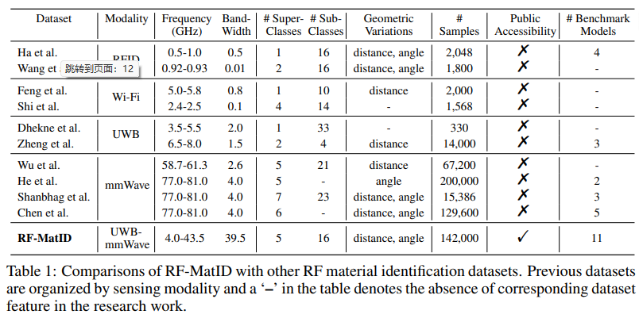
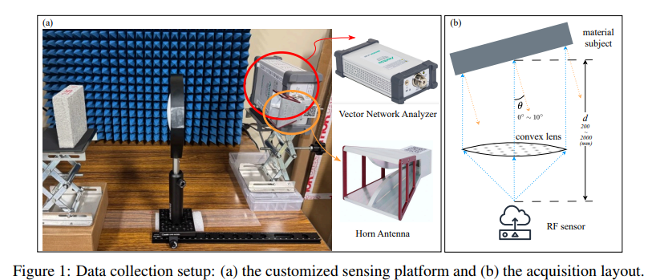
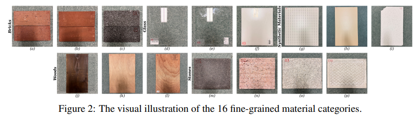
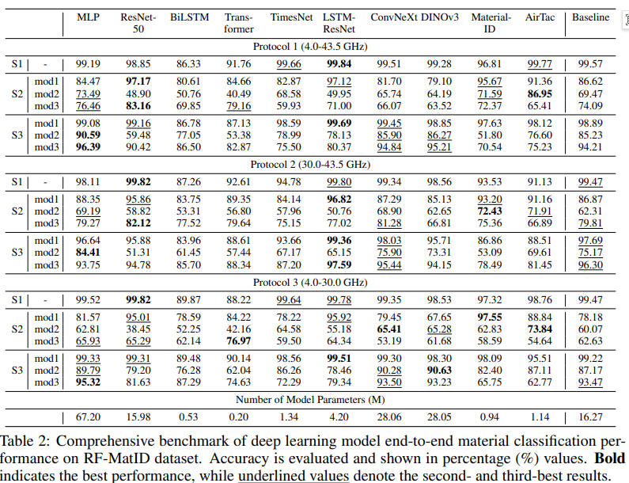
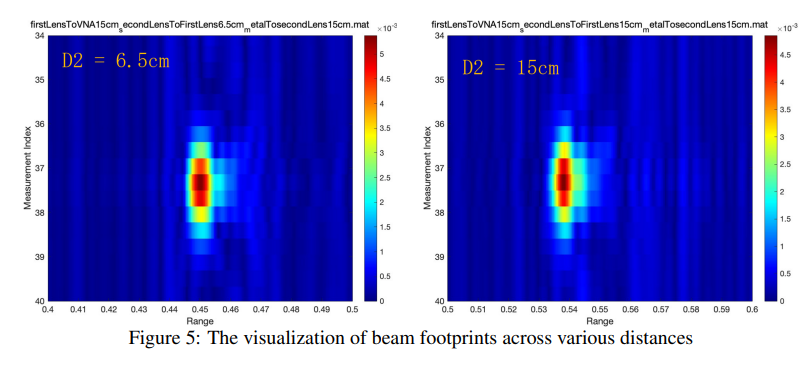
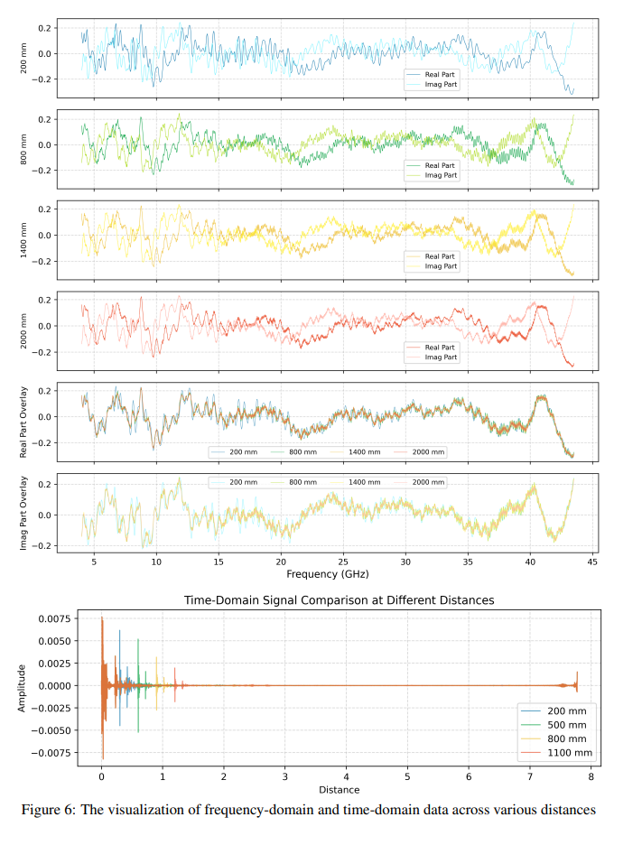

# ICLR 2026 | RF-MatID: Ultra-Wideband Radio Frequency Data Set and Benchmark System for Fine-Grained Material Identification[with Python code]

ICLR 2026 | RF-MatID: Ultra-Bandwidth Radio Frequency (UWB) Data Set for Fine-Grained Material Identification and Benchmark System
🔍 1. Research Background: Bottlenecks in Visual Perception and Research Gaps in Radio Frequency Perception
From an application perspective, the visual perception system exhibits three core deficiencies: Firstly, there is insufficient fine-grained differentiation capability. Materials with highly similar appearances such as metal, wood, and building materials have extremely low optical feature differentiation, leading to a significant ceiling in algorithmic recognition accuracy; secondly, environmental robustness is weak. Changes in illumination intensity, deviations in shooting angles, and scene occlusions can directly result in the failure of the perception model; thirdly, there is a lack of physical perception dimensions. The system cannot capture inherent electromagnetic physical properties such as dielectric constant and conductivity, only achieving surface feature recognition, which is insufficient for high-precision physical intelligent modeling needs.
Compared to optical perception, radio frequency (RF) perception relies on the electromagnetic coupling, reflection, and scattering characteristics of electromagnetic waves with materials. It can effectively characterize the intrinsic physical properties of materials and is not affected by environmental factors such as light and visual obstruction. It is a core technology path for replacing traditional visual perception and achieving high-precision material identification. However, in the current stage of development in the field of fine-grained material recognition by RF, long-term limitations are imposed by the imperfection of data resources and evaluation systems, with significant research pain points:
❌ 1. Lack of standardized open-source big data resources, existing public data samples are limited in quantity and have a single scenario, making it difficult to conduct algorithm training, comparative validation, and result reproducibility;
❌ 2. The coverage of the frequency band is prominently limited, and the existing datasets mainly focus on narrow-band frequency bands such as WiFi and UWB, lacking comprehensive signal data covering wide bandwidths and millimeter waves, which cannot support the performance evaluation of algorithms across all frequency bands.
❌ 3. Real-world disturbances are absent, and most datasets do not include geometric variables such as detection distance and incident angle. Laboratory-trained models have a significant domain shift from real industrial and robotic operation scenarios.
❌ 4. The absence of a unified benchmark evaluation system, the data division methods, experimental protocols, and evaluation metrics used by different studies are inconsistent, making it impossible to compare model performance horizontally.
In response to the aforementioned research gaps in the industry, our team has constructed the RF-MatID dataset and accompanying benchmark system. This initiative systematically addresses the data and evaluation shortcomings in the field of radio frequency materials identification, providing a standardized research foundation for the iterative optimization of physical artificial intelligence and radio frequency perception algorithms.
2.1 Comprehensive Construction of Bi-domain Data 📡 The dataset employs a dual-domain, simultaneous collection scheme in the frequency and time domains, comprising a total of 71k pairs of homogeneous bi-domain samples, with a total data volume reaching 142k, achieving comprehensive coverage of signal representation. The frequency range covers 4GHz to 43.5GHz, integrating centimeter wave and Q-band millimeter wave bands, with an effective bandwidth of 39.5GHz. Through high-density frequency point sampling, it precisely captures the differentiated electromagnetic scattering characteristics of different materials, addressing the issues of narrow band signal characteristic singularity and insufficient discriminability.
At the material dimension level, the dataset is divided into five major material superclasses and further subdivided into 16 categories of industrial and indoor high-frequency application materials, covering mainstream categories such as bricks, glass, synthetic panels, solid wood, and stone, encompassing the vast majority of civilian and industrial perception scenarios. Simultaneously, the dataset labels various materials with physical parameters such as size, density, and surface roughness, establishing a precise mapping relationship between "radio frequency signal characteristics - material physical properties," providing data support for research on intelligent algorithms constrained by physical constraints.
2.2 Real-world Geometric Perturbation Simulation 🎯 To address the issue of poor generalizability of laboratory models in real-world applications, the dataset systematically introduces core geometric perturbation variables from real operational scenarios. The radio frequency signal incidence angle is controlled within the range of 0°–10°, with fine sampling at 1° intervals; the detection distance spans from 200mm to 2000mm, with gradient settings at 50mm intervals, fully simulating posture offsets and distance changes during robotic and inspection equipment operations, significantly reducing the domain gap between experimental environments and real application scenarios.
2.3 Standardized Multi-dimensional Benchmarking System 📊
To achieve a comprehensive and fair evaluation of algorithm performance, RF-MatID has established a benchmark system covering frequency protocols, data partitioning, and model evaluation, effectively resolving the issue of industry evaluation standards being inconsistent.
At the frequency protocol level, a 5-class standardized frequency band scheme is designed, encompassing full spectrum, pure cm wave, pure mm wave, and China-US commercial compliance bands. This scheme also accommodates the comprehensive exploration of academic research and the compliance requirements for industrial implementation.
At the data partitioning level, seven refined data segmentation modes are set up, including basic random partitioning and multi-dimensional distribution out-of-distribution (OOD) test partitioning schemes. This comprehensively verifies the model's generalization robustness under scenarios of cross-distance and cross-angle domain shifts, aligning with the perception needs of real complex scenes.
At the model evaluation level, 11 mainstream deep learning architectures are included, covering classic models in four major areas: computer vision, natural language processing, time series analysis, and radio frequency perception. Unified experimental parameters and evaluation metrics are established to construct a comprehensive baseline system for algorithm performance, providing authoritative benchmarking for subsequent algorithm iterations. Additionally, it supports dual-task modes of 16 fine-grained classifications and 5 super-class coarse-grained classifications, adapting to different levels of research needs.
📈 III. Core Experimental Results and Academic Analysis Research Team based on the RF-MatID standardized benchmark system, completed systematic comparative experiments in multiple scenarios and models, and through quantitative analysis, obtained several research conclusions that are highly informative, providing a core reference for subsequent design of radio frequency material perception algorithms.
1. Frequency domain signals exhibit superior modeling efficiency compared to time-domain signals that require complex time-frequency transformations. Raw frequency domain radio frequency signals can directly adapt to deep learning models, ensuring the advantages of recognition accuracy while effectively reducing algorithm computational complexity and inference costs, making them more suitable for lightweight deployment requirements on embedded devices.
2. The impact of different geometric domain offsets on model performance is significantly different. Cross-detection distance domain offsets result in a 16.59% decrease in average recognition accuracy, while cross-angle domain offsets only lead to a 4.02% decrease in precision, proving that distance changes are the core interference factor affecting the stability of radio frequency material identification; at the same time, experiments verify that millimeter wave bands have stronger anti-disturbance capabilities against distance perturbations, while centimeter wave bands are more suitable for angle dynamic changes, providing data support for band selection.
3. Compliant commercial frequency bands possess the potential for undamaged grounding. The model recognition accuracy of legally authorized commercial frequency bands in China and the United States approaches that of full-bandwidth frequency bands, proving that without occupying vast bandwidth resources, high-precision material identification can be achieved with existing compliant transmit frequency bands, significantly reducing the barriers to engineering implementation and compliance costs.
4. Deep learning methods significantly outperform traditional radio frequency sensing algorithms. Traditional algorithms such as mSense and RFVibe have an accuracy of less than 10% in fine-grained material identification tasks, with significant deficiencies in feature extraction and fine-grained discrimination capabilities. However, deep neural network-based modeling methods can effectively mine the latent features of radio frequency signals, making them the optimal technical path for high-precision radio frequency material identification at present.
5. The generalization performance of various models is clearly layered by their features. The LSTM-ResNet hybrid architecture, combined with the self-developed baseline model, exhibits optimal stability and generalization capabilities. MLP models possess excellent static scene fitting abilities. Lightweight time series models have a simple structure and fast inference speed, but they are relatively limited in adaptability to domain shift disturbances.
🔭 4. Research Limitations and Future Research Directions
In the realm of algorithmic research, subsequent integration with Physical Information Neural Networks (PINN) can be considered to embed physical prior knowledge such as electromagnetic wave propagation and electromagnetic coupling into the model training process. This approach aims to address the issues of weak interpretability in deep learning models and insufficient generalization in extreme scenarios, thereby advancing the development of radio frequency perception technology that integrates data-driven approaches with physical constraints.
✨ 5. Research Value and Application Prospects
In the field of engineering applications, relying on the core advantage of RF perception unaffected by light and obstruction, algorithms trained based on this dataset can be widely adapted to scenarios such as autonomous grasping in embodied robots, industrial assembly line material sorting, building non-destructive testing, and full-house intelligent environmental perception. This effectively breaks through the technical bottlenecks of traditional visual perception, providing core technical support for the practical application of physical artificial intelligence.
As a groundbreaking research achievement included in ICLR 2026, RF-MatID fills the gap in ultra-wideband fine-grained radio frequency material identification. It provides standardized open-source research foundation for researchers in the fields of radio frequency perception, embodied intelligence, and physical AI, aiding in the technological iteration and industrialization of the industry.

## Images

<!-- PAYMENT_BLOCK -->

## Get this dataset

- Payment link (Stripe): [Buy now](https://buy.stripe.com/3cs8yP7sY87d0vu9AB)
- Payment QR code: 

<!-- /PAYMENT_BLOCK -->
